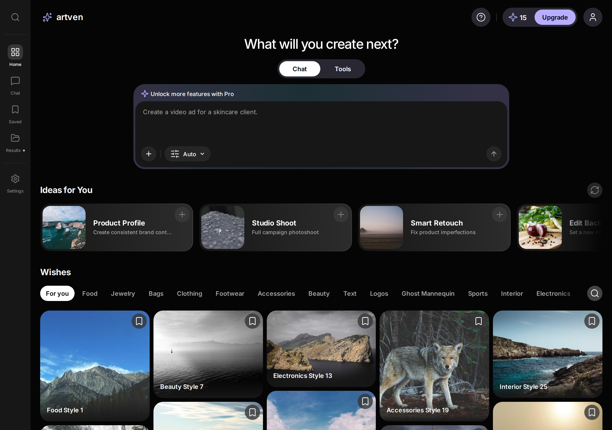
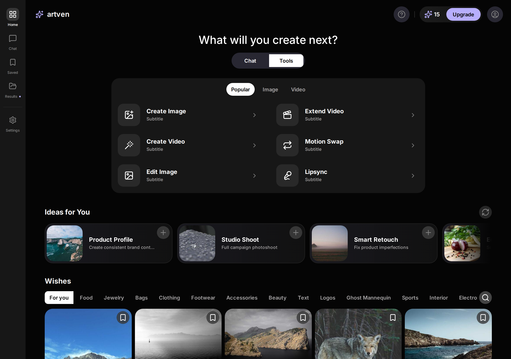
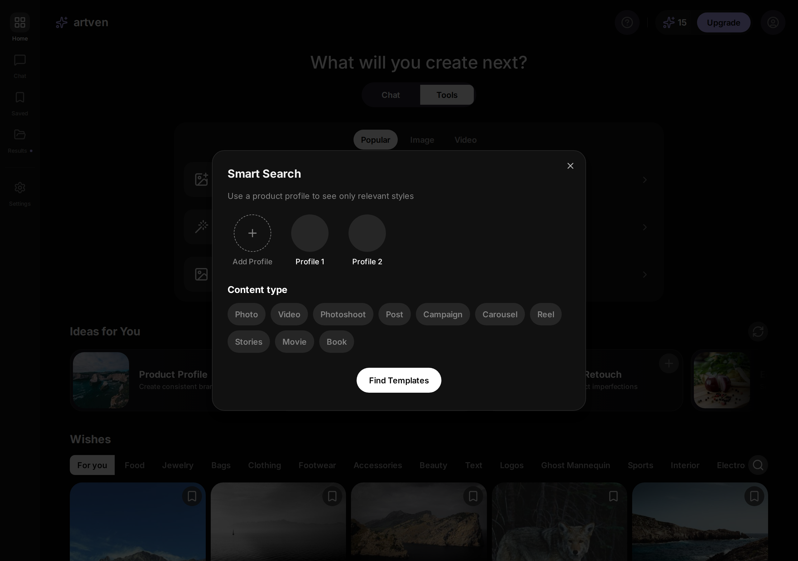
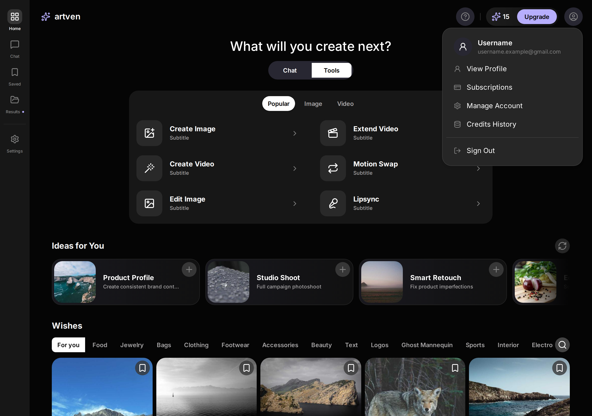

# Artven Web Studio: home page

A test task for glam.ai, written with AI during a technical interview. It is the home screen of Artven, an AI content studio, built from a Figma mockup: a user starts a chat, picks a creative tool or reuses a template. There is no backend: all data comes from mock functions.

[](https://github.com/Anu3ev/glam.ai-test/actions/workflows/ci.yml)
[](https://github.com/Anu3ev/glam.ai-test/actions/workflows/release.yml)

**Demo:** <https://anu3ev.github.io/glam.ai-test/>



## What works

- **App shell.** Sidebar navigation with the active page marked, a header with the Help menu, credits, Upgrade and the Profile menu. Sign Out and Sign in work with a mock user.
- **Chat and Tools modes.** The switch is stored in the URL (`/?mode=tools`), so reload and Back keep it. Chat mode has the prompt composer with a model menu; Tools mode has Popular, Image and Video tabs.
- **Ideas for You.** A horizontal row of idea cards with a refresh button.
- **Wishes.** Category chips, a masonry grid with save and Use buttons, and the Smart Search dialog that filters templates by content type.
- **Keyboard and screen readers.** Landmarks, a skip link, accessible names on buttons and links, and menus and dialogs that work from the keyboard and return focus.

| Tools mode | Smart Search | Profile menu |
| --- | --- | --- |
|  |  |  |

## Stack

Vue 3, TypeScript, Vite, Vue Router, Pinia, Tailwind CSS v4, shadcn-vue (Reka UI) and Lucide icons. Tests run on Playwright.

## How it was built

- Sizes, gaps, radii and colors come from the Figma file through the REST API (`scripts/fetch-figma.ts`), not from screenshots.
- Each part was built on its own branch and merged through a pull request after a green CI run: lint, type-check, build and Playwright. Feature pull requests also went through a code review before the merge.
- Every decision is in the [decision log](docs/decisions/README.md), with the reason and its cost.

## Getting started

Requires Node 24 (see `.nvmrc`).

```sh
npm install
npm run dev
```

| Command | What it does |
| --- | --- |
| `npm run dev` | Dev server |
| `npm run build` | Type-check and production build |
| `npm run type-check` | `vue-tsc` only |
| `npx eslint src e2e` | Lint without fixes (`npm run lint` applies fixes) |
| `npm run test:e2e` | Playwright tests, including computed-value checks against the Figma design |
| `node scripts/fetch-figma.ts [name nodeId...]` | Refresh the cached Figma data; needs `FIGMA_TOKEN` in `.env.local` |
| `node scripts/capture-screenshots.ts` | Update the screenshots above from a running `vite preview` |

## Releases

The demo shows the latest release. To ship a change, bump `version` in `package.json` in its pull request (`npm version <patch|minor|major> --no-git-tag-version`: patch for fixes, minor for features, major for breaking changes). After the merge and a green CI run on `main`, the Release workflow builds that commit, deploys it to GitHub Pages and publishes the GitHub Release `v<version>` with the merged pull requests as notes. The version must be `X.Y.Z` and greater than the latest release. Merges without a version bump do not change the demo. Bump one version per merge: with several quick bumps, releases follow the order CI finishes, so a middle version can be skipped. Running the Release workflow by hand redeploys the latest release, for example after a lost Pages deployment.

## Project structure

| Path | Responsibility |
| --- | --- |
| `src/pages/` | Route pages; they compose sections and hold no logic |
| `src/components/app-*/index.vue` | Application components, one kebab-case folder each, with their child components inside |
| `src/components/ui/` | shadcn-vue primitives generated by the CLI |
| `src/api/` | Mock API functions with a short delay; a real client can replace them |
| `src/stores/` | Pinia stores; they call only `src/api/` |
| `src/types/` | Shared data types |
| `src/assets/style.css` | Tailwind entry, Figma colors, radius steps and text styles (`text-<role>`) |
| `e2e/tests/` | Playwright tests |
| `scripts/` | Figma data and screenshot scripts |
| `docs/` | Decision log, feature summaries, tooling |

## Known limitations

- Images are placeholders from picsum.photos, the logo is a Lucide icon, and Lucide icons stand in for the Figma icon set.
- Figma has no mobile frame: below 640 px the header drops the wordmark and the credit count; the page reflows down to 320 px.
- In Smart Search, product profiles do not filter the grid, and "Add Profile" is a placeholder.
- The fade over the last row of tools is left out on purpose; it would dim the only row on the Image and Video tabs.

## Documentation

- [Decision log](docs/decisions/README.md)
- [Home page summary](docs/features/home-page/summary.md) and [plan](docs/features/home-page/plan.md)
- [Tooling and dependency rules](docs/tooling.md)
